<a href="https://ibramdawwa.de">
  <picture>
    <source media="(prefers-color-scheme: dark)" srcset="assets/hero-dark.svg">
    <source media="(prefers-color-scheme: light)" srcset="assets/hero-light.svg">
    
  </picture>
</a>

  

  
  <a href="https://de.linkedin.com/in/ibrahem-angro">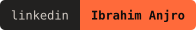</a>
  <a href="https://www.instagram.com/ai.with.ibrahim">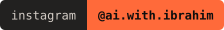</a>
  <a href="https://ibramdawwa.de/contact">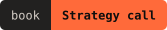</a>
  

 

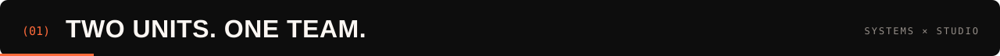

Growth gets stuck in two places: **slow processes** and **expensive content**. Most partners fix one of them. We built two units under one roof, so better ads bring in more leads and smarter automation turns them into customers faster.

  <a href="https://ibramdawwa.de/systems"></a>
  <a href="https://ibramdawwa.de/studio"></a>

 

Every call, chat, form and email runs through one flow: captured, qualified, logged in the CRM and visible in the report.

<picture>
  <source media="(prefers-color-scheme: dark)" srcset="assets/flow-dark.svg">
  <source media="(prefers-color-scheme: light)" srcset="assets/flow-light.svg">
  
</picture>

  

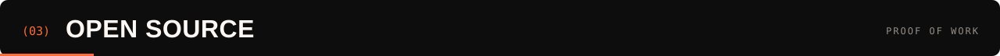

| Project | What it is | Why it matters |
|---|---|---|
| [**search-central-live-2026-knowledge-base**](https://github.com/IbramDawwaGmbH/search-central-live-2026-knowledge-base) | 2,228 claims from Search Central Live Deep Dive Europe 2026, graded against Google's docs. Developer kit, field guides, offline edition. | SEO answers your team and your AI agents can check against a source. |
| [**KI-Transparenz-EU**](https://github.com/IbramDawwaGmbH/KI-Transparenz-EU) | Labels AI-generated and AI-modified images, video and audio on WordPress, visibly and accessibly, with a record of every decision. | Transparency for AI media under EU rules. |
| [**the-nib**](https://github.com/IbramDawwaGmbH/the-nib) | A small pixel-art creature for your Windows taskbar that opens your AI assistant with the prompt already typed. | AI that fits into the work day. |
| [**traceDemo**](https://github.com/IbramDawwaGmbH/traceDemo) | TRACE: a website concept and 32-second brand film for a fictional brand, rendered in code. | Motion design without a video editor. |
| [**zerothDemo**](https://github.com/IbramDawwaGmbH/zerothDemo) · [**metra-demo**](https://github.com/IbramDawwaGmbH/metra-demo) | Concept websites for fictional brands. | How we stage a brand on the web. |

 

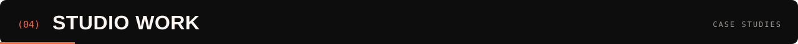

<!--
  STUDIO REEL: export a 6–8 second loop of the case-study visuals as assets/reel.webp (under 5 MB),
  then replace this comment with:
  

  TRACE FILM: edit this README on github.com and drag the .mp4 file into the editor.
  GitHub uploads it and inserts a user-attachments link that plays as a video. Put that link here.
-->

AI media production for brands in beauty, wellness, health and jewellery, cut for every placement: 9:16, 4:5 and 1:1.

| Brand | Category | Format |
|---|---|---|
| [Leo Jewelries](https://ibramdawwa.de/work/leo-jewelries) | Jewellery | 4:5 feed |
| [Elacia](https://ibramdawwa.de/work/elacia) | Skincare · self-tanner | 9:16 story |
| [Ezmio](https://ibramdawwa.de/work/ezmio) | Nail care | 4:5 feed |
| [exoskin](https://ibramdawwa.de/work/exoskin) | Beauty & body care | 4:5 feed |
| [Hlth+](https://ibramdawwa.de/work/hlth) | Health & nutrition | 1:1 square |
| [Essintial Oils](https://ibramdawwa.de/work/essintial-oils) | Wellness · essential oils | 1:1 square |

<a href="https://ibramdawwa.de/work">All projects →</a>

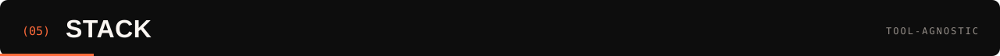

<picture>
  <source media="(prefers-color-scheme: dark)" srcset="https://raw.githubusercontent.com/IbramDawwaGmbH/IbramDawwaGmbH/output/github-snake-dark.svg">
  <source media="(prefers-color-scheme: light)" srcset="https://raw.githubusercontent.com/IbramDawwaGmbH/IbramDawwaGmbH/output/github-snake.svg">
  
</picture>

<b>Ibrahim Anjro</b>, managing director of Ibram & Dawwa GmbH

 

- Builds AI systems and AI media for companies in Germany and Europe.
- TEDx speaker: *Slow Is Fast: How to learn new skills and become a specialist*.
- Certified in GreenSock GSAP. International Certified Trainer.
- Works in Arabic, English and German.
- Based in Regensburg. EU-first data processing, tool-agnostic stack.

<b>🇩🇪 Deutsch</b>

 

**Agenturen automatisieren. Studios gestalten. Wir machen beides.**

Wachstum stockt an zwei Stellen: langsame Prozesse und teurer Content. Wir beseitigen beide, mit KI.

- **I&D Systems:** KI-Telefonassistenten, KI-Chatbots, Workflow-Automation, CRM- & API-Integrationen, Dashboards & Reporting.
- **I&D Studio:** KI-Medienproduktion, Kampagnenmotive in 9:16, 4:5 und 1:1, Websites, SEO.

Mit Sitz in Deutschland · EU-first-Datenverarbeitung · Tool-agnostisch · Rückmeldung innerhalb von 1 Werktag.

👉 [Strategie-Call buchen](https://ibramdawwa.de/contact) · [ibramdawwa.de](https://ibramdawwa.de)

 

